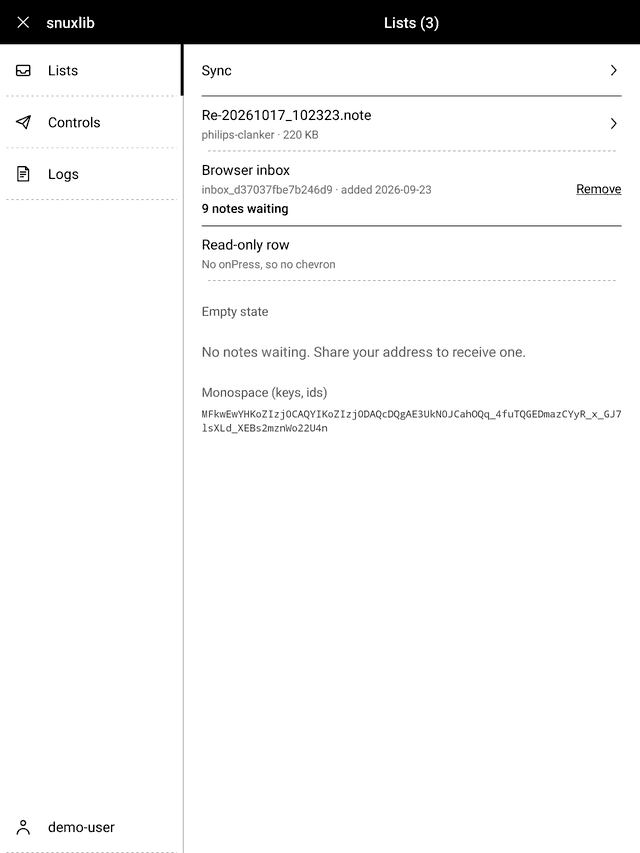
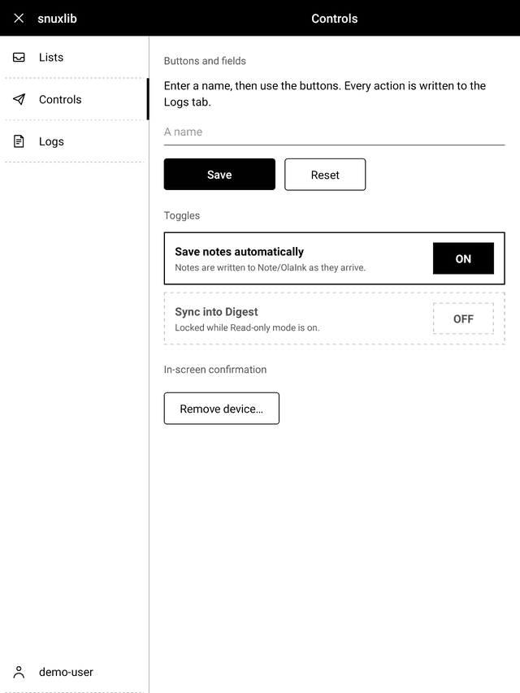
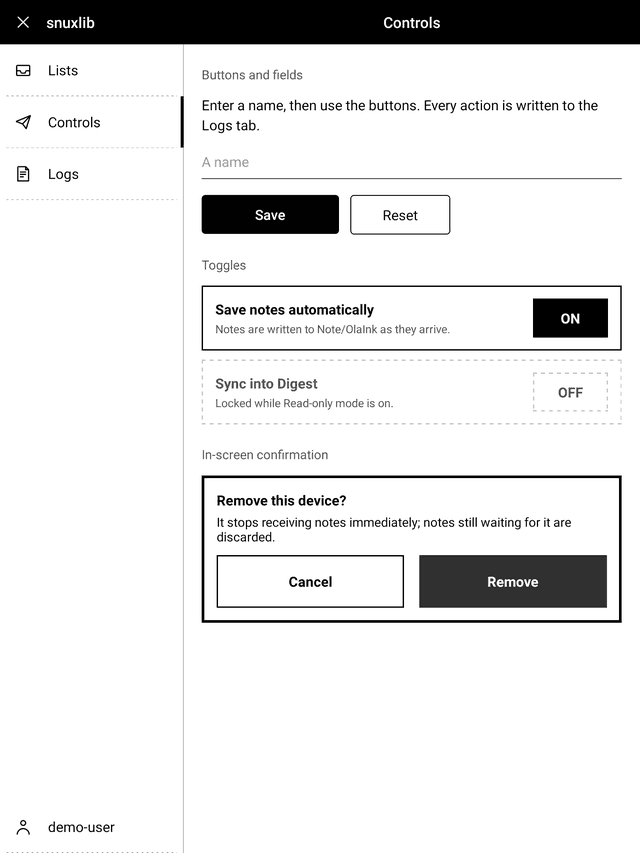
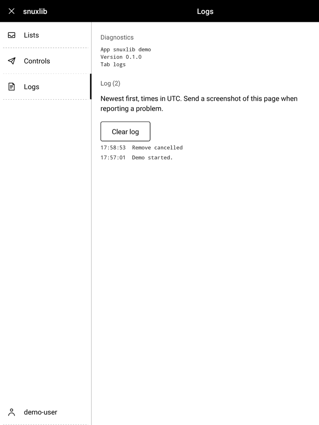

# snuxlib: Supernote plugin UX kit

React Native components that make a Supernote plugin look like part of the
device: the system **Settings** look (black title bar, vertical tab menu with a
selection bar, dashed list rows, big black-and-white buttons) tuned for the
Nomad's 1920x2560 e-ink screen. Extracted from the Ola Ink plugin; used by it
unchanged, and meant for the Readwise plugin and any other `.snplg`.

Depends only on `react` and `react-native`. It does **not** import
`sn-plugin-lib`: the close action is a prop.

| Tab menu / list / buttons / log tab, as rendered on a Nomad | |
|---|---|
|  |  |
|  |  |

## Rules for agents building plugin UI

1. **Use these components; do not hand-roll** rows, buttons, tabs, switches or
   dialogs. If something is missing, add it here (and to `docs/API.md`), then use it.
2. **Never use `Alert`, `Switch`, `Modal` or platform pickers.** They render
   tiny on e-ink. Use `ConfirmPanel` and `Toggle`.
3. **Shape of a plugin screen:** one `PluginScreen` at the root; one tab per
   task (not per setting); account/user settings as a `bottom: true` tab labelled
   with the username (like InkHub); a **Logs** tab on every plugin.
4. **Send every status, result and error to `useLog`.** Plugins cannot be
   inspected from a shell; "send me a screenshot of the Logs tab" is the support
   workflow. Do not show tiny status text at the bottom of pages.
5. **Start each pane with a `SectionLabel` or a `ListRow`**, not body text.
6. Details and measurements: [`docs/DESIGN.md`](docs/DESIGN.md). Props:
   [`docs/API.md`](docs/API.md).

## Quick start

```tsx
import React, { useState } from 'react';
import { PluginManager } from 'sn-plugin-lib';
import { icons, ListRow, PluginScreen, SectionLabel, useLog, LogPane, type TabSpec } from './snuxlib';

export default function App() {
  const [tab, setTab] = useState('home');
  const { entries, log, clear } = useLog({ initial: 'Started.', prefix: 'my-plugin' });
  const tabs: TabSpec[] = [
    { key: 'home', label: 'Home', icon: icons.inbox, onPress: () => setTab('home') },
    { key: 'logs', label: 'Logs', icon: icons.logs, onPress: () => setTab('logs') },
    { key: 'user', label: 'philips', icon: icons.user, onPress: () => setTab('user'), bottom: true },
  ];
  return <PluginScreen appName="My Plugin" title={tab === 'home' ? 'Home' : tab === 'logs' ? 'Logs' : 'philips'}
      onClose={() => PluginManager.closePluginView()} tabs={tabs} activeKey={tab}>
    {tab === 'home' && <>
      <SectionLabel>Items</SectionLabel>
      <ListRow title="Sync now" onPress={() => log('Sync tapped')} solid />
    </>}
    {tab === 'logs' && <LogPane entries={entries} onClear={clear} diagnostics={['My Plugin 1.0']} />}
  </PluginScreen>;
}
```

`demo/DemoApp.tsx` is a complete, working example that uses every element.

## Installing

**A. In the olaink monorepo** (what Ola Ink does): `snuxlib` is an npm
workspace. In the plugin's `package.json` add `"snuxlib": "*"`, run `npm install`
at the repo root, then `import { ... } from 'snuxlib'`. Metro already follows
workspace symlinks (`unstable_enableSymlinks`, `watchFolders` = repo root).

**B. In another repo** (Readwise): vendor a copy. A library that lives outside
the plugin's tree resolves its own `react-native` and risks a second React
instance; a copy inside `src/` uses the plugin's.

```sh
# from the olaink checkout
snuxlib/scripts/vendor.sh ../readwise-supernote-digest/plugin/src/snuxlib
```

Then `import { ... } from './snuxlib'` (relative to the importing file). The
copy is flat, includes the icons, demo and docs, and has a `SNUXLIB_VERSION`
stamp. **Do not edit it**: change `snuxlib/` in olaink, re-run the script,
commit the result. Requirements in the plugin: React Native >= 0.79, React >= 19,
and the bundle step must run with `--assets-dest` (the standard Supernote plugin
build already does) so the bundled icons are copied.

## Trying the demo on a Nomad

The demo replaces the plugin's root component, so use a scratch build. With
the Ola Ink plugin (dev only; it installs over Ola Ink with the same plugin ID,
your keys and journal are kept, and installing the normal build restores Ola Ink):

```sh
OLAINK_PLUGIN_ENTRY=index.snuxdemo.js OLAINK_PLUGIN_VERSION_CODE=<above installed> \
  scripts/snplg-deploy.sh packages/plugin
```

In another plugin: in its entry file, replace `AppRegistry.registerComponent(...)`
with `registerDemo(appName, () => PluginManager.closePluginView())` from
`./snuxlib/demo/registerDemo`.

## Layout

```
snuxlib/
  src/         components, theme, hooks (import from index.ts)
  assets/icons close chevron back inbox send settings pair logs user (64x64 PNG)
  demo/        DemoApp.tsx (all elements) and registerDemo.tsx
  docs/        API.md, DESIGN.md, screenshots/
  scripts/     vendor.sh
```

Tests: `npx vitest run --project node snuxlib` from the olaink root (pure helpers:
log buffer, formatters). Visual changes must be checked on a device; see
"Verifying on a device" in `docs/DESIGN.md`.
